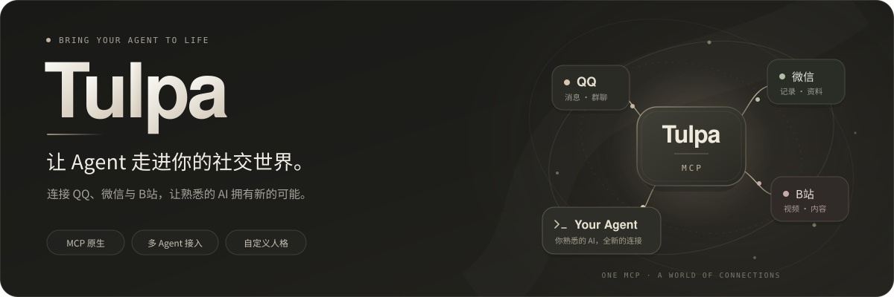
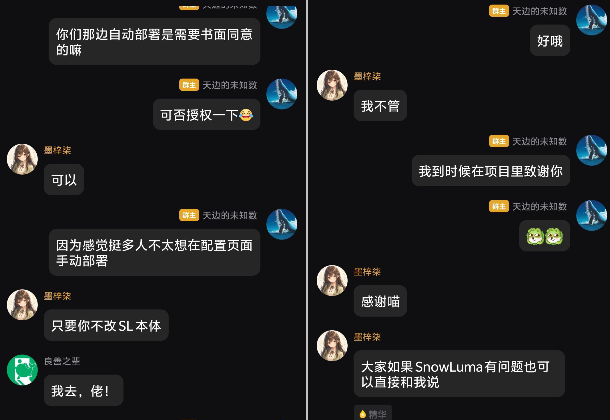

<p align="center">
  
</p>

# Tulpa

此 fork 在上游基础上保留原生文件与图片下载、工作区文件发送、群授权追加及低延迟多群消息获取。功能、权限和验证见 [fork 补丁说明](doc/FORK_PATCHES.md)，后续合并上游并保留自有修改见 [维护说明](doc/FORK_MAINTENANCE.md)。

**使用MCP，让你几乎所有的Agent访问QQ/微信/B站，甚至亲自下场水群！**

> 为推动硅基生命的发展和普及贡献一份力量！

[Linux 终端版](doc/LINUX.md) · [MCP 命令行](doc/MCP_CLI.md) · [下载](#下载) · [快速开始](#快速开始) · [Agent 配置教程](doc/AGENT_SETUP.md) · [使用场景](#使用场景) · [完整文档](#常见问题与文档)

Tulpa 通过同一 MCP 连接提供 QQ、微信与哔哩哔哩能力，三个模块分别授权。Agent 可以查资料、追溯消息、带着自定义人格参与 QQ 群聊，或从视频字幕、真实画面和评论中寻找信息。

**桌面发行版：Windows 10 / 11 x64；Linux：x86_64 / ARM64 终端源码版。**

## 能做什么？

下面是可以交给 Agent 的请求示例。

### 让小鲸鱼来水群

> 用随包的小鲸鱼持续聊天，你也可以自行编写你的人物卡片。

随包提供小鲸鱼（`little_whale`）、小鲸鱼2号（`little_whale_v2`）和龙娘（`dragon_girl`，测试版），你也可以用 Markdown 写自己的角色人设卡片。支持按语境接话、原生 @ 与引用；授权后可看图、发送和收藏表情、给消息贴表情回应，保留理解笔记供后续会话选用。

持续聊天会在当前已授权的机器人账号和群里积累群友表达与黑话，潜水时也能学习；同账号同群重开可接续积累。人物卡与学习参考分开，模型可以选择本轮不用。[聊天节奏](doc/MCP_CHAT_TURNS.md) · [实时学习](doc/MCP_LANGUAGE_LEARNING.md)

人格卡详见 [人格教程](doc/MCP_CHAT.md)与[表情链路](doc/MCP_STICKERS.md)。

视频链接：[点击这里查看哔哩哔哩视频](https://www.bilibili.com/video/BV16jHL6AE5z)

### 刷B站（测试中）

> 直接让Agent帮你刷B站视频，B站信息可直接植入Agent的思维链和工作流。

支持关键词搜索、账号推荐流、视频详情与分 P、带时间戳的字幕、真实抽帧和评论分页。无字幕时可使用已安装的本地 ASR 模型；读不到的内容会明确返回缺失项。B站账号扫码登录，权限在同一 MCP 连接中勾选。[B站使用说明](doc/BILIBILI_MCP.md)

### 找回聊过的资料和文件

> 帮我找我的群里的一些我需要的附件，核对时间，并标出消息来源。

按关键词、人物、会话和日期检索，再展开上下文。图片、语音和文件按需读取；轻量版可经 OneBot 下载 QQ 群原文件，交给同机 Agent 自己的文件工具阅读。


## 为什么用 Tulpa

- **多平台信息整合**：把QQ、微信和哔哩哔哩的能力整合到任意Agent上。
- **安装方便**：具备图形化界面和CLI界面，直接让你的肥鱼全自动配置即可~
- **全自动部署**：自动下载、校验、配置和运行SnowLuma和配置OneBot服务。已获得SnowLuma主开发授权！
- **复用熟悉的 Agent**：MCP协议使得你可以用几乎所有的桌面Agent来使用Tulpa提供的大量接口。

经过测试可完美接入以下。理论上可完全兼容所有已发行Agent：

-  [Codex](doc/AGENT_SETUP.md#codex) ·
-  [Claude Code](doc/AGENT_SETUP.md#claude-code) ·
-  [DeepSeek Harness](doc/AGENT_SETUP.md#deepseek-harness) ·
-  [Antigravity](doc/AGENT_SETUP.md#google-antigravity) ·
-  [WorkBuddy](doc/AGENT_SETUP.md#workbuddy)

## 下载

| 版本 | 适合你，如果你想… | 下载 |
| --- | --- | --- |
| **Windows MCP 版** | 图形界面或命令行，连接已有 Agent | [0.5.7 ZIP](https://github.com/fumingyang2004/Tulpa/releases/download/v0.5.7/Tulpa-MCP-0.5.7-win-x64.zip) |
| **Linux MCP 终端版** | Linux x86_64 / ARM64，CLI/TUI 与 MCP 服务 | [0.5.7 tar.gz](https://github.com/fumingyang2004/Tulpa/releases/download/v0.5.7/Tulpa-MCP-0.5.7-linux.tar.gz) |


**0.5.7 只发布 MCP 版。** Windows 包自带 Python 与命令行入口，使用系统 WebView2 Evergreen Runtime；Linux 包为终端源码包，首次启动安装依赖。语音模型不随包附带。[MCP 说明](doc/MCP_LITE.md) · [最新发布](https://github.com/fumingyang2004/Tulpa/releases/latest) · [0.5.7 更新说明](doc/releases/0.5.7.md)

Windows 需要 **.NET Framework 4.8**。下载 ZIP 后完整解压到可写目录，打开 `Tulpa/Tulpa.exe`；命令行使用 `Tulpa/Tulpa.CLI.exe`。不要从压缩包直接运行，GitHub 自动生成的 `Source code` 也不是 Windows 安装包。QQ / 微信客户端与外部 Agent 需自行准备；SnowLuma 可由 Tulpa 自动配置。

**老用户升级：** 按[保留数据升级教程](doc/UPGRADE.md)检查、备份并更新原目录，无需重新导入。自改的同名随包人格先另存；升级后仍打开原目录 EXE，并重连 MCP。

## 快速开始

### SnowLuma 自动配置

打开并登录 QQ，在 Tulpa 的 **OneBot 设置 → 连接 QQ** 中勾选协议和自动配置授权，点击 **一键配置**。Tulpa 自动准备固定版本 [SnowLuma 2.1.1](https://github.com/SnowLuma/SnowLuma/releases/tag/v2.1.1)，校验运行包、初始化随机凭据、选择空闲端口、配置 HTTP/WS 并核对 QQ 与实时事件。多个 QQ 进程时选择目标，未登录时在 QQ 扫码即可，无需终端、下载路径、手填 Token 或管理密码。

优先使用校验通过的随包运行文件；未随包提供时从官方渠道下载。原有独立 SnowLuma 可在高级选项导入，保留原配置；不会扩大 MCP 授权。第三方许可仍独立适用。[操作与恢复](doc/SNOWLUMA_MANAGED.md) · [本次开发验证](doc/SNOWLUMA_AUTOMATIC_VALIDATION.md)

已取得 SnowLuma 主开发作者对自动部署的书面同意，条件是**不修改 SnowLuma 本体**。[查看授权记录](doc/assets/SnowLuma.png)。使用者仍需在 Tulpa 内主动同意 SnowLuma 协议。

### 我要 QQ 水群

**无需先导入整库历史。** 这条路径直接接收 OneBot 实时事件。

1. 启动 QQ 和 Tulpa；在连接 QQ 中勾选协议并点击“一键配置”，或从高级选项导入已有 OneBot 连接。持续群聊需要 **HTTP + 正向 WebSocket**。[连接教程](doc/SNOWLUMA_MANAGED.md)
2. 点击 **开始创建链接**，启用 **QQ** 模块，选择当前群与持续聊天、发送权限；按需加看图、表情发送或收藏。只水群不需勾选历史读取。
3. 点击 **一键开启 MCP**。名称可留空；按 [Agent 教程](doc/AGENT_SETUP.md)配置并重连客户端。首页可单独启停或删除连接。
4. 在外部 Agent 的**专用对话**中使用上面的水群示例。想换龙娘，选择 `dragon_girl`。新人格放进当前安装目录的 `chatlocal/prompts/mcp_chat/`，重新列出即可发现。

保持 QQ、OneBot、Tulpa 和外部 Agent 运行。宿主结束回合、达到预算、退出或休眠后，Tulpa 不会自行继续推理。可在 Tulpa 点 **停止聊天 / 停止全部群聊**；已发出的消息不会因此撤回。改过人格后，停止并重新开启会话才会采用新设定。

### 我要看 B站视频

1. 在左侧 **B站账号设置** 用 B站 App 扫码登录。
2. 点击 **开始创建链接**，启用 **哔哩哔哩** 并勾选只读能力，点击 **一键开启 MCP**。可以只选 B站，也可和 QQ / 微信共用这条连接。
3. 在 Agent 中刷新工具列表，直接描述想找的话题。模型可自行搜索、读取推荐、字幕/本地 ASR、真实画面及评论。[使用与限制](doc/BILIBILI_MCP.md)

### 我想通过命令行配置

Windows 双击 `Tulpa.CLI.exe`，或在终端执行 `Tulpa.CLI.exe --json status`。Agent 可以直接管理连接、配置 QQ、发起 B站扫码、查询学习库并调用已授权 MCP 工具。[CLI 教程](doc/MCP_CLI.md)；Linux 沿用 `./tulpa` CLI/TUI。

### 我要查 QQ / 微信历史

1. 登录本机 QQ / 微信，在 **数据与同步 → 本机账号**核对账号，再选会话和日期读取。可以从少量近期消息开始。
2. 点击 **开始创建链接**，启用对应的 QQ / 微信模块，勾选聊天记录读取及所需附件权限，选择资料范围。
3. 点击 **一键开启 MCP**，按[教程](doc/AGENT_SETUP.md)接入外部 Agent，从上面的资料查询或总结示例开始。未导入资料时，界面会在选择历史读取后提示导入。

本地历史查询和草稿不需要 OneBot。读取范围受客户端版本、账号、权限及本机缓存影响，无法保证找回未取得的历史；见[数据读取](doc/IMPORTS.md)与[实时摄取](doc/LIVE_INGESTION.md)。

## 隐私与权限

- **资料保存在本机，不等于完全离线。** 必要消息片段会进入你选择的模型服务；启用识图时也会发送所选图片。
- 看图、发送、收藏和群管理分别授权，默认关闭、可撤销。**MCP 的发送和群管理勾选后是持续授权，调用直接执行，不会逐条回到 Tulpa 审批。**
- 微信提供资料读取，回复草稿可由外部 Agent 生成，不提供微信发送能力。
- 不要分享使用过的整个安装目录，尤其是 `data/`、`imports/`、`.env`、Token 和私人诊断。撤销连接不能收回已交给客户端的内容；MCP 范围限制也不是整台电脑的文件隔离。

> [!CAUTION]
> Tulpa 是独立的第三方项目，与腾讯 / 哔哩哔哩无隶属或授权关系。项目仅供学习与技术研究，使用风险自负。

## 相关文档

- 接入与群聊：[Agent 教程](doc/AGENT_SETUP.md) · [MCP 权限](doc/MCP.md) · [OneBot](doc/SNOWLUMA_SETUP.md) · [人格](doc/MCP_CHAT.md) · [表情](doc/MCP_STICKERS.md)
- 资料与调查：[文件](doc/ARTIFACTS.md) · [语音](doc/VOICE.md) · [调查与证据](doc/INVESTIGATION.md) · [工作区](doc/WORKSPACES.md) · [会话记忆](doc/TULPA.md)
- 功能与维护：[完整功能](doc/FEATURES.md) · [回复助手](doc/REPLY_COPILOT.md) · [群管理](doc/GROUP_MANAGEMENT.md) · [升级](doc/UPGRADE.md) · [安全报告](doc/SECURITY.md)

## 参与开发

<details>
<summary>从源码运行与贡献</summary>

需要 Windows x64、Python 3.13 和 Git，在 PowerShell 执行：

```powershell
git clone https://github.com/fumingyang2004/Tulpa.git
cd Tulpa
python -m venv .venv
.\.venv\Scripts\python.exe -m pip install -r requirements/mcp.txt
.\.venv\Scripts\python.exe app_mcp.py
```

打开 <http://127.0.0.1:7861/>。实时 QQ 与 B站不要求安装历史读取器；历史资料及便携包构建依赖见下方文档。

[贡献指南](doc/CONTRIBUTING.md) · [桌面构建](doc/DESKTOP.md) · [验证说明](doc/VALIDATION.md)

</details>

## 许可与致谢

Tulpa 自有代码采用 [MIT License](LICENSE)，第三方组件、模型与客户端遵循各自许可，见 [THIRD_PARTY.md](doc/THIRD_PARTY.md)。本项目不是腾讯官方产品，与 QQ、微信及模型服务商没有隶属关系。

感谢以下仓库提供的参考或支持！

- [qq-bridge](https://github.com/Derpyu520/qq-bridge)：群聊行为与提示词设计参考；小鲸鱼基于其角色卡。
- [MaiBot](https://github.com/Mai-with-u/MaiBot)：会话的组织逻辑和学习机制参考。
- [QQ-agent](https://github.com/K0nd1us/QQ-agent)：表情收藏、语义笔记、候选与用量反馈的设计参考。
- [SnowLuma](https://github.com/SnowLuma/SnowLuma)：提供 QQ / OneBot 接入能力；感谢主开发[墨梓柒](https://github.com/DrSmoothl)对 Tulpa 自动部署的书面授权与支持。[授权记录](doc/assets/SnowLuma.png)
- [墨梓柒](https://github.com/DrSmoothl)：感谢您的开源精神以及对本人的支持！

<details>
<summary>SnowLuma 自动部署授权记录</summary>



</details>
